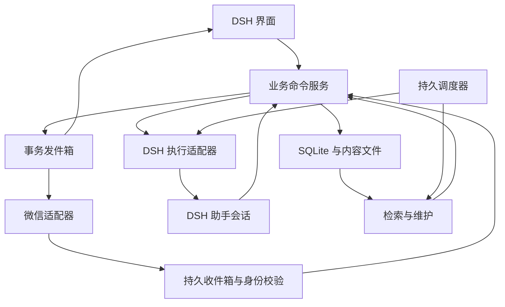

# DSH 个人助手插件：实现说明与验收计划

设计稿 v0.4 · 2026-11-04。以本机 DSH 0.2.1-rc.5 为接口核查起点。本文中的 `assistant.*`、`ChannelAdapter` 等是拟新增接口，不是 DSH 当前已有 API。

产品行为见 [设计说明](05-assistant-design.md)，记忆模型见 [长期记忆专题](07-lifelong-memory.md)。已新增独立技术原型和 [验证报告](08-memory-validation.md)：30 项测试通过，完整链路通过真实 DSH 工具服务运行。该段记录早期原型状态；2026-11-04 已实现并安装正式 bundle，最新能力与验收见 [正式插件实施与验收](11-implementation-progress.md)。真实微信账号尚未绑定。

## 1. 模块组织

一个 npm bundle 提供 Host、Client 和助手 preset；内部按模块拆分，不要求普通用户分别安装多个数据库和服务。

```text
plugins/<package-name>/
  package.json
  cordis.patch.yml
  src/
    host/                   Cordis 服务与生命周期
    client/                 DSH 面板与设置
    domain/                 业务对象、命令、校验
    storage/                SQLite、文件、迁移、差量
    memory/                 抽取、实体、关联、整理、召回
    planner/                项目、任务、日历、优先级
    execution/              DSH 会话与运行结果适配
    tools/                  工具注册、工作流、版本
    channels/weixin/        微信协议与账号状态
    scheduler/              定时任务、租约、补处理
    notifications/          收件箱、发件箱
  presets/
  migrations/
  skills/
  locale/
  tests/
```



所有写入经过领域命令。Client、微信和模型工具不能分别直接改数据库，也不能让模型输出任意 SQL。

## 2. DSH 接口与适配工作

| 需求 | 已核查的本机接口 | 实现任务 |
|---|---|---|
| 插件装载 | Cordis `apply/inject/Config`，`dsh.bundle.patch` | 声明 bundle patch 与 Host/Client 入口，按 [发布方案](10-distribution.md) 打包，初始锁定已测版本 |
| 界面 | `dsh.client`、`./client`、共享模块与 slots | 使用宿主 React 和主题，注册面板、设置与收件箱 |
| 模型工具 | `ctx.tools.register(defineTool(...))` | 暴露少量领域工具，参数严格校验，输出稳定 ID 与操作结果 |
| 对话执行 | `ctx.sessionController`、Agent、preset | 创建/恢复助手会话，保存业务任务与 sessionId 的映射 |
| 记忆接入 | `systemPrompt`、作用域工具、Agent inbox | 在请求开始前准备有预算的记忆上下文；不能在只读 `agent/request` 事件里假装改写消息 |
| 唤醒 | `agent.followup`；`agent.inject` 不会唤醒 | 优先经会话控制器提交，保证路由和持久化策略一致 |
| 请求去重 | session prompt 的 `requestId` 已在队列或日志时复用受理结果 | 每个业务执行使用固定请求 ID，并测试崩溃窗口 |
| 进程 | `dsh-jobs`、subprocess | 跟踪真实执行，业务任务状态保存在插件数据库 |
| 定时 | `dsh-schedule` | 只在需要时作为唤醒桥接，不作为插件所有状态的主存储 |
| 历史 | Session persistence、投影、日志导出 | 通过受支持接口读取；未知事件类型不能随意写入宿主日志 |

助手专用 preset 只影响助手会话。为已有普通会话启用记忆属于可选来源配置，不修改整个 DSH 的所有 preset。

### 已验证的会话接线方式

隔离进程挂载 Agent registry、AgentLoop、Session、SessionProjection、JSONL persistence、SystemPrompt、ToolRuntime 与账号模型适配器。通过 agents.create() 的 setup 注册作用域工具和提示词；创建结束后投递用户消息。agents.resume() 用于从持久日志继续同一会话。

业务完成检查 turn/end 的结果和领域命令写入状态。whenIdle() 仅表示运行循环停稳，模型返回 503 等错误时同样会进入空闲。供应方配置有界重试，业务写入按 sessionId 与 callId 去重；生成时间和其他运行时元数据在首次事务内赋值。

模型抽取与整理分别使用工具集合。抽取侧不能自行指定所有者、来源 ID 或已验证等级；整理侧提交成员版本与统一命题，由领域层生成记录快照和关系变化。自然语言输入、模型工具调用、数据库断言及接入中遇到的问题保存在 [真实会话验证](09-live-session-validation.md)。

发布前优先补上两项：原始命题与派生摘要分层保存、期限由程序生成带时区的显示值。真实链路的数据断言已通过，但模型摘要省略用途和时间标注错误仍被单独记录，不能纳入通过结论。

本机已有 `billion-context` 参与压缩与 preset 装配，集成时须验证与它同时启用的情况。插件不能依赖独占全局压缩钩子，也不能重复注入同一份长期记忆；保存已处理序号与召回来源标记。

### 首个接口验证任务

创建隔离 profile，注册一个只读记忆工具、一个任务写入工具和助手 preset。验证首轮、后续轮、会话恢复、压缩、子代理与 Client 重连。对“回答开始前自动召回”的挂载点做真实时序检查；若某个入口没有可靠前置 hook，就让专用 preset 在该轮首先调用检索工具，不能宣称事件监听已实现自动注入。

## 3. 本地目录

```text
<data-root>/
  manifest.json             数据集 ID、格式版本、最低读取版本
  state.sqlite              当前业务状态、元数据与文字恢复差量
  content/
    blobs/<hash>            受管理附件和当前工具源码
  conversations/            插件拥有的对话归档与保留计划
  projects/                 项目产物入口与受管理文件
  tools/                    当前版本清单、源码入口、依赖锁定信息
  credentials/
    vault.enc               仅兼容旧版加密凭据，新连接不写入
  rollback/
    <content-hash>           大文件恢复内容，按引用与期限回收
  exports/                  用户主动导出的 Markdown/JSON/ICS
  cache/                    可重建搜索和嵌入缓存
  runtime/                  当前设备锁、临时文件、运行信息
```

业务设置由数据库拥有；`manifest.json` 只保存引导与格式信息，不重复维护同一批设置。读取工具源码以数据库指向的内容哈希为准，`tools/` 的文件视图由已提交版本生成；外部编辑通过导入/发布进入版本管理。

内容路径使用内容哈希或稳定 ID，避免 Windows 保留字、大小写冲突和过长路径。导入包检查路径穿越、符号链接、压缩包体积和文件类型。外部文件默认保存引用；用户要求随迁移携带时才复制进受管理内容区。

“完整迁移”包括本插件的全部必要业务内容。外部工作区和用户未选择复制的大文件保留映射项，在新设备可重连。

## 4. 存储与一致性

### 技术选择

使用 TypeScript 和 SQLite；`node:sqlite` 封装在 `StorageAdapter` 后面，在 Worker 中执行同步查询，避免阻塞 Host 事件循环。首先使用宿主内置模块，启动检测 SQLite/FTS5 能力，不默认捆绑额外原生扩展。

本机独立进程实测结果：Node 24.21.0、SQLite 3.53.4，FTS5 创建成功，`sqlite.backup` 为可调用导出。此项只验证 macOS arm64 下的能力探测，不是多系统性能或崩溃恢复测试。[Node API](https://nodejs.org/download/release/latest-v24.x/docs/api/sqlite.html)

为同一目录建立进程级独占写锁，数据库使用事务、外键与唯一键。锁内保存实例 ID；判断崩溃后的锁恢复不能只按文件是否存在。迁移到新设备需要停用旧实例，离线复制产生的两个目录不具备自动跨设备仲裁能力。

### 核心表

| 表/集合 | 关键字段 |
|---|---|
| settings | key、value、version |
| episodes | id、内容、发生时间范围、时间精度、领域、来源、版本 |
| claims | id、主体、谓词、值、有效时间、确认时间、状态、来源、版本 |
| knowledge_items | id、决定/方法/模式类型、适用条件、结果、反例、来源、版本；重要经历在 episodes 中固定 |
| entities / aliases | 稳定 ID、实体类型、名称、别名、归并目标 |
| relations | 起点、终点、类型、来源、适用时间、置信状态、版本 |
| summaries / summary_inputs | 摘要、输入记录 ID 与版本、覆盖范围、待更新状态 |
| memory_sources / forget_rules | 来源定位、提炼游标、屏蔽规则，不用旧正文做删除标记 |
| projects | 目标、状态、领域、家族与外部工作区映射 |
| tasks | 截止日期、估时、重要性、紧急度、依赖、状态、手工覆盖字段 |
| calendar_events / occurrences | UID、时区、全天、重复规则、例外实例、任务关联 |
| execution_runs | taskId、sessionId、requestId、attempt、状态、产物、工具版本 |
| tool_specs / tool_versions | 输入输出契约、能力声明、源码哈希、依赖、验证结果 |
| scheduled_jobs / job_runs | nextDue、时区、补处理策略、租约、游标、结果 |
| changesets / change_items | 动作、对象版本、恢复文件引用、到期时间、撤回状态 |
| inbox / outbox / delivery_attempts | 事件 ID、渠道路由、去重键、投递阶段、结果 |

业务对象还带有数据集 ID、来源类别、可用场景及人工覆盖信息。用途筛选在可信服务层执行，不能接受模型传入一个更高权限的身份标记来绕过。派生内容继承输入中最严格的使用范围，直到用户明确修改。

正文与关系是业务数据；搜索索引是派生数据。向量保存模型标识、维度和文本哈希，新模型索引构建完成后再切换。

### 同一事务应包含什么

记忆或任务的修改、版本递增、关系更新、维护记录元数据与待发通知一并提交。事务提交后由发件箱发送通知；网络失败不回滚已完成的本地修改。

大型文件先写入临时路径、刷盘并原子发布，再将内容哈希写入事务。事务失败留下的未引用文件由回收器清理；回收器同时检查活动任务和未过期恢复资料的引用。

## 5. 记忆管线

领域接口建议包括 `capture`、`search`、`getTimeline`、`correct`、`pin`、`link`、`consolidate`、`forget`；它们服务于 UI 和模型工具，具体工具数量在接口验证后确定。

捕获器接收增量消息和任务结果，来源字段由适配器填入。模型只生成候选事实、时间解析建议和关系候选。代码执行类型校验、来源校验、实体身份检查、幂等检查和版本冲突检查。

明确保存的事实快速提交；复杂关联放入后台。自动整理只读取选定批次、相关历史和依赖，返回结构化修改计划，不直接持有数据库写权限。

记忆召回先过滤所有者和用途，再按实体、关键词、时间、向量与关系组合。核心资料设置小预算，项目检索另外分配预算。无嵌入服务仍可用关键词、别名与关系查询；向量服务失败不阻断对话。

后台提炼通过 DSH 可用的模型服务调用，并控制持久日志中的内容。不得把完整旧记忆作为维护结果写入长期日志，也不能在一次普通 Agent 会话中反复输出所有待删除原文后又宣称已经清理。上线前核查宿主模型调用日志与遥测实际保存的字段。

维护输出使用固定动作集合：新增、修正、合并、分类、关联、解除关联、汇总、删除。所有动作引用对象 ID、预期版本和原因代码；过大批次拆为可独立撤回的小批次。简单命题去重优先保留既有主记录 ID；生成全新综合摘要作为另一种动作处理。

## 6. 撤回、到期与故障恢复

### 6.1 提交流程

1. 读取一组对象的版本快照，在事务外生成维护计划。
2. 检查保护项、依赖、允许的动作和预算。
3. 如涉及大文件，先完成受管理文件的持久写入；小型文字差量准备为同库载荷，正式版加密。
4. 开启数据库写事务，核对预期版本与受影响的关系集合；发生变化则重新规划。
5. 应用修改、更新关系、对象版本与字段修改序号，同一事务写入差量、到期时间以及通知发件项。
6. 提交后发布变更结果；索引按提交序号更新，追上之前可降级到主数据查询。

文字差量、数据变更与通知在同一事务中共同提交或回滚，此方案已通过真实子进程退出检查。大文件尚未登记就崩溃时，它是孤立暂存文件，可清理；已登记且事务完成时，引用与变更均有效。文件丢失或校验失败时标记恢复异常，暂停会扩大影响的自动修改。大文件流程与加密仍需后续验证。

数据库事务不跨越模型调用和网络等待。没有模型输出时不应留下长时间持有的数据库写锁。

### 6.2 撤回算法

逐项读取当前版本，与批次修改后的版本比较。相同则可执行反向修改；不同则按字段修改序号比较。没有交叉修改的字段自动恢复，有交叉修改的字段保留当前内容并提供选择。即使后续字段值与整理后的值相同，只要有新的写入序号，也不能自动覆盖。

合并涉及多个实体、别名和连接时，整个关联组作为一个恢复单元；不能出现正文恢复但关系错乱。恢复本身写入新版本和结果记录，并保证重复提交撤回请求是幂等的。

规划后新增或移除引用同样构成并发变化。多个归并组之间的关系统一计算最终状态；撤回时若依赖对象已经删除，整个恢复单元保持原状并返回冲突。撤回完成后保存不含正文的归并屏蔽规则，避免下次自动维护立即重做同一归并。正式版为该规则提供恢复自动整理的入口。

### 6.3 到期清理

从批次完成时间起算 72 小时，保存 UTC 到期时刻；用户时区只影响展示。运行中按时间检查，启动时先检查，读取恢复资料时再检查一次。系统时间回拨不能用来自动延长已记录的窗口。

到期删除恢复正文、仅被恢复资料引用的文件和对应缓存；批次元数据只保留不含内容的编号、计数和状态。删除记录、全文索引和 SQLite WAL 的回收要统一处理，不能只删文件名。程序级清理不替代用户自行保留的系统快照或导出副本。

恢复空间达到预算时先清理已到期和孤立文件；仍不足则暂停新的一批有损维护，不提前清理仍在窗口内的资料。当前数据、活动任务引用的工具版本不是备份，继续保留。

## 7. 原文保存与 DSH 会话衔接

插件对话归档以消息/事件 ID 和序号增量保存，附件按内容哈希引用。90 天到期后先核对核心事实、决定、成果及未完成事项是否已提炼，再分批清理普通细节。

DSH 的原生 Session 日志采用受校验的追加格式，不能从外部直接删几行；当前 persistence seam 没有通用逐条删除方法。必须把两个实现目标分别验收：

1. 插件归档的 90 天保留、完整迁移和继续任务上下文。
2. 原生助手会话是否能通过受支持的专用持久化/导入导出机制纳入同一目录并滚动归档。

第二项作为前置技术验证：检查助手作用域能否使用官方 persistence 后端和目录配置、Agent factory 如何取得服务、会话列表与日志导出的路由如何保持一致。禁止直接替换整个桌面的存储路径影响其他会话。

如果作用域方案可用，优先使用宿主原格式和既有校验器；如果只能全局配置，首版维持宿主存储，并在插件内提供完整逻辑归档和新会话接续。设计和发布说明必须对应实际完成的方案。现阶段尚未证明可以原样导入所有原生会话，也未执行任何原文清理。

## 8. 调度与执行

### 持久调度

调度表是主状态，内存 timer 只是唤醒器。使用下一次到期时间安排单个 timer，主机恢复、时间变化、配置变化时重新计算。

领取任务时在事务中取得租约与 `runId`；同目录一个写者，各类别使用独立任务 ID。恢复过期租约时先读取执行阶段，不能把所有旧任务一律重新执行。

| 任务类型 | 错过后处理 |
|---|---|
| 记忆整理、工具回顾 | 合并为一次增量工作，保存进度继续 |
| 恢复资料清理 | 立即处理到期内容，不调用模型 |
| 用户提醒 | 汇总过期项，展示原计划时间 |
| 外部执行 | 核对时效、已有结果与幂等能力，再决定继续或待核实 |

### 执行状态

业务命令受理、DSH inbox 持久化、模型开始、工具运行、产物验证、任务完成、通知发送是不同阶段。仅有 `followup` 或 schedule 回执不能标记任务完成。

本地副作用通过唯一业务键去重。对于外部系统，使用其提供的幂等键；没有这类能力且超时发生在发送后，进入结果待核实，不以“重试直到成功”处理。

自动执行沿用 DSH 权限与预先授权范围。微信所有者通过稳定平台 ID 绑定，适配器不能直接把任意入站消息当作 Host owner 调用所有工具。

## 9. 日历实现

使用经过验证的 RFC 5545 解析/生成库，选择前检查许可证、时区支持和重复例外测试。首版不自己用字符串拼接实现完整规则。

保存本地日期、原时区、UTC 瞬时和全天类型；按场景使用适合的字段。全天日期不转成 UTC 零点；夏令时缺失和重复时刻采用明确的规则，并与 UI 解释一致。

事件系列、某次实例和例外分开。重复展开只计算当前视图和近期提醒需要的区间，不提前生成无限未来实例。ICS 导入按 UID、RECURRENCE-ID 和版本属性检查冲突，重复导入保持幂等。[RFC 5545](https://datatracker.ietf.org/doc/html/rfc5545)

分类与重要性由模型给建议，时间冲突、时区、依赖、提醒和可用区间由确定性代码计算。用户锁定的字段保存覆盖标记。

## 10. 工具系统

工具规范包含：ID、版本、用途、输入 JSON Schema、输出契约、所需能力、允许目录/服务、依赖、入口和测试。DSH 原生工具与用户生成工具使用不同注册命名空间，不能覆盖官方同名工具。

声明式工作流只引用已注册的能力，使用固定解释器执行，无 `eval`、任意 shell 拼接或动态 Host 模块导入。工具参数经过结构校验和正确的进程参数传递。

脚本工具在受控进程执行，并继承实际可用的系统与 DSH 执行策略。新生成代码先做静态检查和隔离样例验证；后台自动构建只接触临时目录和测试输入。不能在“测试工具”的名义下访问用户真实账号或发送真实消息。

工具版本采用不可变内容哈希，运行开始即固定版本。更新与撤回切换注册指针，不中途更改正在运行的代码。旧版本删除前检查任务、定时工作和恢复资料的引用。

依赖按平台重新安装或取得兼容产物，保存锁文件与来源，不将整个 `node_modules` 当作迁移数据。后台维护不自动扩大能力集合，也不因依赖提示就执行任意安装脚本。

## 11. 微信适配器

对内定义稳定接口：连接、扫码状态、接收、回复、发送通知、发送文件、断开；每项同时声明当前可用能力。

初始验证两种可实施路径：扩展 DSH-IM 的微信契约，或基于腾讯官方协议实现窄适配器。正式产品选择其中一个消费者。上游没有提供的 API 不能写进实现依赖清单当作现成能力。

入站原始 ID、账号 ID、发送人 ID、消息时间和内容构成持久信封；由代码建立身份和路由，模型只处理业务内容。持久入库及去重后再推进接收游标，在协议不提供强确认时用重放去重补足。

回复保存该会话最新可用上下文和客户端消息 ID；账号重新绑定时清除旧身份相关路由。发送前冻结目标，不能让待发任务在用户改绑后自动投往新账号。

平台返回成功只记录接受；含糊超时进入未知状态。没有公开确定的主动推送窗口时不写死“永远可发”或固定时长。通知内容采用短摘要，避免长文本大量分段；已有成功分段不再次发送。[腾讯协议](https://github.com/Tencent/openclaw-weixin/blob/main/docs/protocol_zh_CN.md)

正式版至少验证：扫码登录、退出再绑定、所有者校验、文本往返、文件往返、断网、重启恢复、长时间无消息后的通知、发送途中超时、同账号被另一个实例接管。

## 12. 凭据与迁移

微信登录不要求插件口令。通过 @napi-rs/keyring 2.1.2 将凭据存入系统安全存储，以数据集身份隔离记录：macOS Keychain、Windows Credential Manager、Linux Secret Service。Linux 显式要求持久 Secret Service，不静默退回重启即丢失的内核存储。

系统安全存储是新微信登录凭据的唯一持久来源。迁移目录不带走本机登录状态，新设备重新扫码。系统存储不可用时显示错误，不回退到明文文件。凭据不进入记忆、日志和模型上下文。旧版 vault.enc 保持兼容，用户主动恢复时读入系统存储。普通业务数据库默认不声称已加密；若增加整库加密，需要同时处理索引、临时文件与附件。

导出流程：暂停新写入与自动执行，等待在途本地提交，固定内容引用集合，通过 SQLite Backup API 生成一致快照，复制该快照引用的内容，生成校验清单，原子完成导出。文件回收在导出期间持有引用租约。不能在应用运行时直接只复制主数据库文件。[SQLite Backup](https://www.sqlite.org/backup.html)

导入流程：检查目录格式和校验和；以只读方式预检；检查数据版本与宿主版本；执行可恢复的数据迁移；重建缓存；重新映射路径；检查工具依赖；最后启用调度；微信在新设备扫码后启用。

新设备默认不自动补发未决外部消息，不重新执行结果未知的任务。确认只有一个活动实例后再接管渠道和调度。迁移是交接，不是把两个活动目录放进同步盘实时合并。

数据库结构升级使用有序迁移。升级前的一致快照只保留一份，并有明确到期策略；失败时回到旧数据或只读恢复。较旧插件打开较新格式时拒绝写入，不能损坏它不认识的字段。

## 13. 工程难度与阶段安排

下列为工程估算，不是已经执行的工期：假设一位熟悉 TypeScript、SQLite 和桌面插件的开发者全职，使用现有 DSH 能力，有三系统测试设备并能进行微信账号验证。按顺序推进约 18–27 人周；需求继续扩大或宿主接口需上游修改会增加时间。

| 阶段 | 交付物 | 估算 |
|---|---|---|
| A：可行性验证 | preset 记忆接入、微信往返、差量恢复、目录迁移、三系统安装骨架 | 2–3 周 |
| B：数据与记忆 | 事务、领域模型、时间线、实体关联、捕获与检索 | 4–6 周 |
| C：计划与执行 | 日历/ICS、任务状态、DSH 执行与结果回收 | 3–4 周 |
| D：维护与工具 | 自动整理、72 小时清理、冲突撤回、工具构建与版本 | 4–6 周 |
| E：微信与迁移 | 正式账号状态、收发恢复、系统凭据存储、兼容依赖 | 2–3 周 |
| F：公开测试 | 多系统真实流程、故障注入、升级恢复、文档与打包 | 3–5 周 |

开发阶段按模块推进，首个公开版本再合并交付完整闭环；不能把某阶段的文字聊天原型当作最终七项能力已经完成。

| 部分 | 难度 | 主要原因 |
|---|---|---|
| Cordis 包、面板和设置 | 中 | 需要遵守 DSH 的加载与 Client 模块约定 |
| 本地记忆 CRUD 和关键词搜索 | 中 | 数据结构明确，需中文检索与版本化 |
| 多年关联、时间纠错和自动遗忘 | 高 | 相似不等于相同，摘要可能失真，必须长期评测 |
| 三日撤回与关系一致性 | 高 | 并发修改、恢复依赖和过期回收需要完整协议 |
| 日历和重复规则 | 中高 | 时区、全天、重复例外和导入去重 |
| DSH 完整执行衔接 | 中高 | 对话受理与业务完成不是同一事件 |
| 自动生成并维护工具 | 高 | 版本、依赖、执行权限和跨系统差异 |
| 微信正式接入 | 高 | 平台状态、主动发送、凭据及消息恢复需实测 |
| 单目录迁移 | 中高 | 一致快照、密钥、外部路径与宿主会话衔接 |

## 14. 验收与评测

### 数据与恢复

在模型规划后、恢复文件写入后、数据库提交前后、发件前后分别模拟中断。重启后不出现半条记忆、断裂关系、丢失有效恢复资料或重复外部执行。多实例竞争同一目录只有一个写者。

对 72 小时测试使用可控时钟：到期前可恢复；到期后所有读取路径均不可获取旧正文；启动和后台清理删除恢复文件及派生缓存。磁盘满时已提交内容完整，未过期恢复资料不被提前回收。

### 记忆

采用 [记忆专题的长期场景](07-lifelong-memory.md)；补充同名实体、跨年度相似项目、纠错后摘要更新、无答案、中文短词、跨领域外发和删除后重提炼。比较整理前后关键问题的可回答性、错误归并、错误遗忘和处理成本。

公开研究评测可辅助检验抽取、时间推理和多会话关联，但最终还要使用未参与调参的本项目用例。评价单位是问题或事件，保存对应结果；不能用数据库体积下降代替记忆质量。

### 日历与执行

测试 DST、时区切换、全天、多次 ICS 导入、重复实例单次改期、用户手工优先级、取消与完成；工具结果未知时不出现完成状态。恢复后不重发过期业务动作。

### 迁移与跨系统

至少进行 macOS→Windows、Windows→Linux、Linux→macOS 的资料往返验证；选定架构以真实 DSH 发行包为准。验证中文路径、大小写、文件锁、长路径、系统换行、时区和依赖恢复。各平台需完成微信、调度和目录切换的实际流程。

不能只以 TypeScript 编译或某台 Mac 上的单元测试作为多系统完成的依据。界面交付前验证日历编辑、筛选、撤回冲突、微信配置和窄屏布局。

### 公开发布

公开仓库已确定为 `McLinWxl/dsh-personal-assistant`，自动测试与标签发布流程见 [GitHub 同步与插件发布](10-distribution.md)。正式包目录为 `plugins/dsh-personal-assistant/`。开发源码同步与可安装版本发布分别记录；未完成正式包验收时保持发布开关关闭。

固定依赖和兼容范围；生成包内容清单、版本变更与迁移说明；保留复用代码的许可证声明；测试从 GitHub Release 的 `.tgz` 包链接安装、升级、停用和卸载。卸载默认保留用户数据目录，删除数据作为单独明确操作。

## 15. 本轮实际完成的核查

- 读取本机当前插件和 DSH 服务实现，形成前置开发资料。
- 核对 `dsh-schedule` 的运行条件、持久化和投递语义。
- 核对 `sessionController` 的受理、请求 ID 去重、会话恢复及原生日志约定。
- 核对 DSH-IM 5.2.0 的微信实现、主动发送和当前 Companion 契约覆盖渠道。
- 在应用自带 Electron Node 的独立进程中探测 SQLite、FTS5 和备份导出符号。
- 查阅官方产品文档、项目源代码、论文和 SQLite/iCalendar 文档，写入本套设计。

记忆链路技术原型已经完成，实际覆盖和结果见 [验证报告](08-memory-validation.md)。本机 Node 与 DSH 自带 Node 均通过 30 项测试；真实 Cordis/ToolRuntime 复用了同一完整场景。真实 Agent 与模型接入、自然语言流程及设计调整见 [会话验证](09-live-session-validation.md)。独立语义质量评测、微信、多系统运行和真实用户数据迁移仍需后续验证。阶段 A 已完成记忆事务链路的一部分，尚未完成全部四条链路。


## 2026-11-04 正式实现补充

正式代码位于 `plugins/dsh-personal-assistant/`，采用 MIT。以 [正式实施记录](11-implementation-progress.md) 和 [实测检查记录](validation/formal-live-20261104.json) 为当前状态。前文的阶段表是开发路线，并不代表每项均已完成验收。

维护使用 DSH 提供方直接生成受约束的 JSON 提案，来源提炼、分类刷新和归并分开执行。原始命题与派生摘要双层保存已进入正式代码。模型新增或自动修改工具默认生成草稿。工作流逐步进入原生工具管线，固定版本执行完结束；任务回合完成进入待核对，不自动当作业务完成。

部分更新参数使用去除默认值的补丁 schema；只有显式提交的字段参与修改。原生会话日志由宿主管理，迁移采用插件逻辑归档和新会话接续；切换数据目录后旧原生会话绑定失效，避免继续写旧工作目录。普通原文默认 90 天清理，撤回差量默认 72 小时，二者分别计时。

微信文件采用官方 CDN 协议和加密传输；接入身份固定为二维码绑定的主人。账号和真实消息验收由用户最后绑定完成。Windows、Linux 原生 DSH 操作及长期记忆质量评估仍需相应环境与持续资料。

## 全局会话接入更新

Host 全局注册记忆工具与提示词组装钩子，监听全部用户根会话的 session/event。来源先缓存，回合结束后交给补充提炼队列；消息 ID 去重。个人助手通过 workspaceRegistry 注册为原生工作区，任务与报告通过 sessionController.create({workspaceId}) 归属其中。Client 删除聊天页与 chat RPC，保留业务管理及跳转原生执行记录。详见 [原生工作区接入](12-native-workspace-integration.md)。
