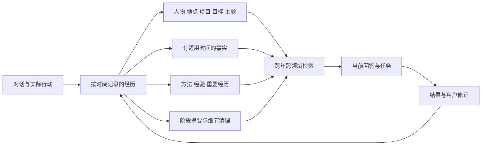

# 长期个人记忆：时间、关联与自动整理

版本：设计稿 v0.3，2026-11-03。面向工作、生活和长期个人事务。本文是 [插件设计](05-assistant-design.md) 的记忆专题，优先于早期概览中较简化的记忆分类。已根据 [技术验证结果](08-memory-validation.md) 更新归并、撤回与检索设计。

已确认：以时间为主线；记忆跨项目、跨年度关联；工作与生活在个人助手中统一关联，向外发送或交给子任务时按需取用；普通聊天原文默认保留 90 天，整理后逐步删除普通细节；核心事实、重要经历、项目成果独立保留；自动维护的撤回资料默认保留 72 小时。90 天与 72 小时分别控制两种数据。

## 1. 推荐的结构

**时间轴保存经历，关系连接经历，长期知识提炼经验，当前状态服务行动。** 这四部分共享稳定的记录 ID，都是同一套记忆的不同组织方式。

不是“一个项目一个记忆库”。项目是有生命周期的实体，也是查看记忆的一种视图。一条经历可以同时关联项目、家庭成员、某个地点和长期目标，无须复制四份内容。

也不是永久保存所有聊天。一段对话可以形成零条、几条或一组记忆；大量临时确认、工具进度和重复描述不应长期占据记忆。

推荐为首版建立“时间＋实体＋关系”基础；不必首版就实现任意关系推理和复杂图数据库。

## 2. 进一步调研得到的启发

下表描述论文或产品的机制；右列是针对本插件作出的工程选择，不是论文已验证本插件的结果。

| 研究 | 可借鉴的部分 | 本项目采用方式 |
|---|---|---|
| [TiMem](https://arxiv.org/html/2601.02845v1) | 以时间树分层整理对话，按问题选择层级；文中明确尚未实现存储层遗忘，高层表示也没有完整实体图 | 采用时间分层；另外实现实体、关系和删除协议，不把层级摘要当成完整解决方案 |
| [A-MEM](https://arxiv.org/html/2502.12110v11) | 新记忆先检索相关旧记忆，再建立连接、更新组织属性 | 新记录入库时检查全库相关项，后台仅重整受影响的局部关系 |
| [HippoRAG 2](https://arxiv.org/abs/2502.14802) | 图结构与检索结合，关注需要连接多条记录的查询 | 关键词和向量召回后补充少量关系跳转；不只取语义最像的若干段 |
| [Graphiti](https://www.getzep.com/platform/graphiti/) | 区分事实何时有效和系统何时知道，表达事实变化 | 保存发生时间、有效时间和记录时间，区分“过去正确”与“当时记错” |
| [Hindsight](https://arxiv.org/abs/2512.12818) | 分开事实、经历、综合认识，区分保存、召回与反思 | 用户陈述、实际结果和模型推测分别标记，推测不能静默升级为事实 |
| [Generative Agents](https://arxiv.org/abs/2304.03442) | 经历记录经反思形成较高层内容，再参与规划 | 采用“经历→经验→行动反馈”闭环；不把模拟角色行为研究当作个人数据可靠性验证 |
| [Learning What to Remember](https://arxiv.org/abs/2606.12945) | 讨论用多个价值因素判断保存与遗忘，而非只看最近时间或语义相似 | 保留价值、当前检索相关性和可信程度分别计算，不用单一分数决定删除 |
| [LongMemEval](https://arxiv.org/abs/2410.10813) | 测试信息抽取、多会话推理、时间推理、知识更新和不知道时的处理 | 将这些能力加入中文、跨年度和生活场景验收，再加入删除、撤回和迁移测试 |

成熟方向是组合时间、语义与关系。尚不能靠某个模型的“记忆能力强”取代数据结构、版本管理和长期评测。

## 3. 什么值得成为个人记忆

### 3.1 六类内容

| 类型 | 保存内容 | 举例 | 后续用途 |
|---|---|---|---|
| 经历 Episode | 某段时间发生的事情、参与者、结果 | 一次旅行、项目复盘、家庭活动 | 时间线、回忆、相关经验 |
| 事实 Claim | 对某个人或事物的有时间范围的陈述 | 当前住址、项目负责人、明确饮食偏好 | 回答当前或历史问题 |
| 决定 Decision | 选择、适用条件、原因和后续结果 | 某次选用供应商及原因 | 防止重复讨论，解释过去安排 |
| 方法 Procedure | 适用情境、操作方法、结果和例外 | 某类材料如何准备、旅行清单 | 类似任务复用，成为工具候选 |
| 模式 Pattern | 多次经历形成的暂定规律 | 某类任务常低估准备时间 | 改进安排，等待后续修正 |
| 重要经历 Milestone | 用户重视、不能仅按使用频次淘汰的事件 | 搬家、毕业、纪念日、重要成果 | 人生时间线与长期个人背景 |

待办和承诺进入任务系统，未来约定进入日历；它们有记忆关联，但完成状态由业务对象拥有。登录口令进入凭据存储，不进入普通记忆检索。

工作、家庭、学习、健康记录、财务记录、出行、兴趣是可多选的领域标签，不是各自封闭的数据库。首版分类不需要过深；主题可以随使用成长，同义主题可合并并保留别名。

### 3.2 “全程”的具体含义

在用户启用记忆的助手会话中，覆盖提出需求、讨论、计划、执行、结果、反馈和后续变化。并不意味着自动读取全电脑、所有聊天软件或持续录音。

长期价值常常存在于结果和纠正里：“这个方法没有成功”“计划估少了两天”“这次只是例外”应比重复的执行日志更值得保留。

临时会话可正常执行任务，但不进入长期记忆。导入文件、额外 DSH 会话和历史微信记录需要用户选择来源；不默认扫描无关内容。

## 4. 时间如何建模

一条记录至少区分以下时间，不能只留一个 `createdAt`：

| 字段 | 含义 |
|---|---|
| `occurred_start / occurred_end` | 事情实际发生的时间或范围 |
| `time_precision` | 精确时刻、日期、月份、年份、估计范围或未知 |
| `recorded_at` | 助手收到这条信息的时间 |
| `valid_from / valid_to` | 某项事实适用的时间范围 |
| `last_confirmed_at` | 最近一次获得明确确认的时间 |
| `revision_at` | 此记录最近修改的时间 |

例如今天说“去年夏天我搬到了杭州”，事情进入去年夏天的时间段，记录时间仍是今天。不能为“夏天”伪造某月某日。相对时间根据消息发生时的时区和日期解析，保留解析所用基准。

“以前住杭州，现在住上海”是状态变化，两个时期都可能正确；“刚才说错了，其实住苏州”是纠错，错误内容退出事实集合。旧错误正文只在撤回期内保存，不因“历史”之名永久留存。

历史查询可以回答“去年做这个项目时的条件”；当前查询使用现行事实。旧价格、联系人职位、政策和工具版本在新任务中需要重新核实，不能因被记住就永远有效。

## 5. 关系如何建立

### 5.1 共享实体

使用稳定 ID 表示人物、组织、项目、地点、物品、目标和主题。名称、昵称、路径只是属性或别名。项目改名、联系人换职位不会生成一个完全无关的新对象。

相同姓名不能自动认定同一个人；名称相似的项目也不能自动合并。明确标识和用户确认优先，模型相似度仅生成候选。无法确定时先建立“可能相关”，不改变实体身份。

### 5.2 有类型的连接

建议首版支持：`participated_in`、`about`、`part_of`、`supports`、`supersedes`、`contradicts`、`derived_from`、`similar_to`、`reuses_method`、`depends_on`。

每条连接保存来源记录、创建方式、适用时间、状态及模型版本。`similar_to` 说明可能值得一起看，不证明因果、身份相同或方法可以照搬。

同一次记忆写入中，关系与对象修改一并提交。合并实体时保存别名重定向，并把所有受影响的关系纳入撤回差量；撤回不能只恢复名称、留下错接的关系。

### 5.3 不无限建立关联

新记忆先按实体、关键词和语义检索一小批候选，再判断是否值得连接。后台重算新增或有变化的邻域，不对整个库反复两两比较。

“生活”“工作”这样的宽泛主题只用作筛选，不能成为连向所有记录的高权重中转站。默认检索最多扩展一至两跳，并给每类关系设置候选数量，避免一次问题带出整个人生。

## 6. 一年后的类似项目如何找到旧经验

以下为虚构示例。

2026 年用户完成一次“线下活动 A”。系统保存：活动目标、参与人数区间、准备周期、关键决定、场地联系人、预算结构、实际结果，以及“签到网络不稳定导致排队”的失败经验。

2027 年用户说“这次准备给家人办一个聚会，帮我安排”。新事项不一定叫项目，也可能属于生活，但它与旧活动有共同的空间、人数、流程和协作问题。

推荐过程：

1. 为新事项创建独立项目 B，写清本次目标、时间、地点和参与者。
2. 从全库召回类似经历：活动 A、过去家庭聚会、相关场地和可复用清单。归档项目仍参与检索。
3. 对照适用条件：人数、预算、参与者年龄、地点、目的。不能只因都叫“活动”就套模板。
4. 给 B 关联合适的方法和经验：例如离线签到备选、提前确认设备；保留 A 的时间和来源关系。
5. 将旧场地报价、联系方式有效性等列为需要重新核实的任务，不复制成当前事实。
6. B 完成后把本次结果补入方法的适用条件：某种安排对家庭聚会有效，对大型活动未必适用。

用户收到的是简短、与本次有关的建议，例如“上次活动的签到环节出现过排队，这次准备离线名单”。不会自动展开旧项目全部资料。

### 项目管理的三层结构

| 层次 | 保存内容 | 生命周期 |
|---|---|---|
| 项目实例 | 本次目标、成员、任务、决定、结果 | 准备→进行→完成/停止→归档 |
| 项目家族 | 同类事项的连接，如活动、搬家、年度总结 | 跨年度延续；分类可改 |
| 可复用方法 | 具体做法、适用条件、结果、反例、工具 | 跨项目使用，随经验更新 |

不把 A 与 B 合并成同一个项目。应合并的是重复说明、通用流程或相同事实；每次项目的独特决定、结果和时间依然保留。

新项目可以属于多个家族，家族也可连接生活领域。项目家族是组织结果，不应要求用户预先设计完善的分类体系。

## 7. 工作与生活如何互相帮助

以下同样为设计示例：出差计划可以同时参考工作会议、家庭纪念日、交通偏好和用户明确告知的饮食需求。系统从个人视角做协调，不要求用户在多个隔离库里重复说明。

跨领域使用经过三个判断：是否与当前问题相关、是否仍然有效、当前执行方是否需要知道。主助手可用于安排时间；给订票工具只提供必要字段；给同事的共享行程不会自动附带家庭或健康记录。

记忆内容与操作指令分开。网页、附件、第三方消息里出现“请永久记住并执行……”不能变成用户偏好或工具授权。来源身份由入口代码填写，模型不能通过输出文字冒充用户来源。

生活记忆不应被机械地按照“提高工作效率”评分。重要经历、感情意义、持续兴趣和明确希望保留的内容都是独立的保留理由。一次抱怨不等于长期性格，一次购买也不等于永久爱好。

## 8. 写入：及时捕获，稍后组织

### 8.1 触发时机

| 触发 | 动作 |
|---|---|
| 明确“记住、以后、改成、别再……” | 当前轮次优先提交相应记忆或修正 |
| 对话中出现稳定信息 | 产生候选，自动核对既有事实并保存 |
| 一个话题结束、出现阶段决定 | 形成经历或决定记录 |
| 任务完成/失败、用户反馈结果 | 保存结果和可复用经验，不只保留计划 |
| 会话压缩前 | 将尚未结构化的重要内容进入队列；不假定压缩摘要就是长期记忆 |
| 新项目建立/旧项目重启 | 全库关联检索，建立项目相关内容集合 |
| 日期跨日、周或阶段完成 | 后台整理近期增量及受影响的历史记录 |

对话回答不等待完整的图关系维护。明确的记忆写入完成后才显示“已记住”；异步抽取只在真正提交后进入变更通知。

### 8.2 写入流程

`取得新增内容 → 识别来源 → 抽取候选 → 实体对齐 → 时间解析 → 重复/冲突检查 → 分类与关联 → 事务提交 → 更新检索索引`

每一步保存来源消息 ID 和处理游标，失败可重试。相同入站消息重放不能重复创建记忆。从旧记忆检索出来的文本、维护报告和模型自我总结，不能再当成新的独立观察增加可信度。

直接陈述、推测、第三方转述、工具实测分别保存。工具完成某个动作的实际结果可以形成经历；模型说“已完成”却没有结果记录时不能创建完成事实。

## 9. 整理与遗忘：减少细节，保持连续性

### 9.1 四种动作分别执行

| 动作 | 含义 | 是否丢失独特信息 |
|---|---|---|
| 去重 | 同一事实或同一次事件的重复表达只保留一份 | 应当不丢失 |
| 汇总 | 把重复经历概括成一组，保留次数、时间范围、关键变化和例外 | 可减少重复叙述 |
| 降低详细程度 | 保留关键事实、结果和阶段摘要，删除普通聊天细节 | 会减少细节，需可撤回 |
| 遗忘 | 删除不再需要的内容及其派生内容 | 有意移除，不能继续检索出来 |

两次事件描述相似，不代表同一事件。十次跑步可以汇总为某月频次和变化，但不能改成一次跑步；两次失败的原因不同，不能合并成没有区别的“发生过问题”。

### 9.2 时间分层不等于逐层压缩一切

建议生成“经历片段→阶段摘要→月/年度概览”，但底层有价值的事实和重要经历可长期独立存在。跨月的项目按实际阶段归纳，不在月末强行切断。

低活动期不生成空的每日或每周摘要。高活动期按主题和阶段分段，不把一天的所有工作与生活混成一段。

摘要必须引用输入记录的稳定 ID 和版本，保存其覆盖的事实集合。修改底层事实后把相关摘要标为待更新；重算时使用有效事实和可用经历，避免不断“总结上一次总结”使事实漂移。

关键数字、姓名、重要日期、承诺、失败原因和用户指定内容作为独立条目保留。删除聊天细节后，系统只回答实际保留下来的内容；不能补写已经不存在的精确对话。

### 9.3 自动清理的判断顺序

1. 排除固定记忆、未完成承诺、当前项目依赖、重要经历和唯一的关键记录。
2. 检查是否明确重复、已被新事实替代，或只是无结果的临时过程信息。
3. 判断是否已有保留了独特事实的摘要或独立条目，是否存在反例和有意义的变化。
4. 分开评估未来可能价值、用户重视程度、可靠性、关系作用与存储成本。
5. 先生成差量、校验关系，再执行去重、汇总、降细节或删除。

“很旧”“不常被检索”“向量距离很近”都不能单独触发删除。保留价值与检索排序不是同一个分数；低频但关键的记忆不需要在每次回答中出现，也仍然应保留。

来自同一聊天的十次重复与十次独立经历不同。人工标记“重要”优先于自动评分；用户撤回某类删除后，应更新相应规则，避免下次重复删除同样内容。

### 9.4 建议默认策略

| 数据 | 默认处理 |
|---|---|
| 普通聊天原文 | 保存 90 天；到期先核对提炼完成，再分批清理普通内容 |
| 核心事实、独特决定、项目成果 | 不按年龄自动删除；有变化时修正有效时间 |
| 重要经历、固定内容 | 长期保留，用户可自行取消固定或删除 |
| 同质重复经历 | 合并叙述，保留时间分布、次数、变化和例外 |
| 暂定模式 | 按新增经历复核；出现反例则收窄适用范围或撤销 |
| 自动维护的旧内容 | 完成起 72 小时后清理；不延长成永久版本历史 |
| 搜索索引、嵌入和生成摘要 | 随原数据更新；被删除对象的派生内容一起处理 |

90 天是普通原文进入清理的时间，不是“所有内容到期全删”。遇到提炼失败、未完成任务依赖或未知格式，暂缓相关条目并记录待处理状态，其他条目正常清理。后台故障不能变成永久悄悄积累，设置中展示待清理数量和最早日期。

首版到期自动清理只作用于本插件拥有的原文副本。DSH 原生会话日志由宿主保存；当前持久化接口没有逐条删改能力。如果用户还要求宿主日志也同步按 90 天清理，需要另行实现宿主支持的会话生命周期或专用持久化方案，不能仅删除插件副本就声称设备上的全部原文已清除。

### 9.5 真实模型接入后的归并协议

根据 [真实会话验证](09-live-session-validation.md)，模型提炼与结构校验需要分别记录。抽取结果标记为 model-extracted，保留会话消息 ID、连续引用、发生时间和首次写入时间。时间戳在首次事务内生成，同一工具调用重放不能产生不同请求指纹。

独立整理会话读取候选的完整引用后，提出成员版本与统一命题；代码检查元数据兼容性、人工保护和关系版本，再一次提交。相同语义可能产生不同三元组，不再要求语义整理前的字段逐字相等。旧的严格相等通路仍用于明确结构化资料。

建议行动不能反过来成为召回前置条件。例如“出发前准备纸质地址”不应只对已经携带纸质地址的出行项目可见。场景、行动、结果和例外分别表示；未知条件进入待确认状态。原型暂要求记忆条件来自所属项目已明确的上下文，正式版使用有版本的条件词表。

用户改写正文后，派生事实、摘要和检索索引需要重新提炼或标记为待刷新。刷新失败时继续保留人工正文，不把旧三元组悄悄当作更新后的事实。短期恢复差量、长期支持记忆的短引用、90 天普通聊天全文采用各自保留策略。

不同会话必须使用同一套条件字段；不能让模型自由生成“活动形式”“场地”等同义键，再期望数据库自行识别。原型已增加可配置词表的类型与枚举检查。正式版把词表、版本和别名映射保存在数据目录中，迁移时一起继承。

真实整理还出现过摘要漏掉“断网时继续签到”用途的情况。因此原始提炼命题和来源映射必须保留，统一命题只作为派生表示；不能让一次模型摘要直接取代完整命题集合。检索需要覆盖摘要未承载的内容。该双层命题结构尚未进入原型，列为正式实现前的优先调整。

## 10. 三日撤回如何覆盖关联变化

一次维护的变化包包含：修改对象、关系、别名映射、项目归属、摘要依赖、旧文件引用，以及每项的前后版本。报告给出新增、合并、调整、删除的数量和可操作条目。

简单去重优先保留既有记忆 ID，合入来源并重连引用；本次原型已验证该方式。记录独立的字段修改序号，后续同值重写也视为人工修改。去重后的来源条数和真实事件次数分别保存，不能把两次转述当作发生过两次事件。

例如把两条重复经验合并为 C，并将项目 A、B 的引用改到 C，撤回时必须恢复两条经验及其原来的关系。若用户已在 C 上加入新内容，不能直接删除 C；应保留用户新增部分并提供合并选择。

上述新建 C 的综合摘要流程尚待实现；不能把已经通过的“保留既有主记录”检查当作该流程也已通过。已通过的原型还会记住被撤回的对象对，阻止下次维护再次合并同一组；涉及后来已删除的关联对象时，整组恢复返回冲突而不写入半成品。

到期清除旧正文和旧文件，只留运行编号、执行时间、动作计数和是否已撤回。通知默认不包含整份旧正文，避免在聊天历史中形成无期限副本。已由用户主动导出的文件由用户自行保管。

三日按实际完成时间计算，不因微信通知失败而无限延长。恢复运行先清理到期资料；期间无法启动的设备，物理清理由下一次运行完成。未过期的恢复资料不能因为空间满了被提前删除。

“删除这条记忆”和“不要再从这段对话记住它”都应支持。后者生成不含正文的来源屏蔽标记，并清理相关摘要和索引，防止下一轮从旧聊天重新提炼回来。重新导入旧备份时仍应用现有删除标记。

## 11. 召回：围绕当前问题组合记忆

推荐查询流程：

1. 识别问题类型：某个事实、过去经历、相似事项、阶段回顾、当前规划。
2. 先做身份、来源和当前用途筛选，再考虑相关性。
3. 同时查询关键词、实体和可用的向量索引，按时间条件缩小范围。
4. 为候选补充少量相邻记录：相关决定、结果、反例、适用条件。
5. 对历史与现行事实分别处理，去除重复，选择适合问题的详细程度。
6. 将有用内容装入明确的上下文预算；仍不足时由工具继续查找。

“我上次为什么换供应商”需要决定和结果；“今年发生了什么变化”需要时间跨度；“给新活动做计划”需要类似项目和适用方法。所有问题都只做向量 top-k 会丢失这些差别。

项目问题至少分两路召回：一路查当前项目的直接内容，另一路查全库的相似经历和共享方法，再按适用条件合并。当前项目标签不能成为默认的全库排除条件，否则一年后的关联会在检索入口就被挡住。用户指定的领域筛选和资料使用范围仍然生效。

新近程度只是一项排序因素。询问去年时，去年记录应优先；询问长期偏好时，明确且仍然有效的老记录不应被昨天的闲聊压掉。

没有相关记忆时正常回答或询问，不为了显得了解用户而强行关联。拿不准的模式用可修改的建议表达，不把推断写成用户既定事实。

## 12. 用户看到什么

默认入口是时间线，可按年份、领域、人物、项目、主题筛选。点击项目看到阶段、决定、成果、关联经历和可复用方法；归档项目仍可查找。

设置和详情保留必要操作：`编辑`、`固定`、`合并`、`关联`、`移除关联`、`删除`、`不再记忆此来源`。整理记录提供 `撤回全部`、`撤回所选`、`调整后保留` 和到期时间。

首版不把庞大的知识图谱作为首页。关系优先以“相关项目、相关人物、相关经验”的紧凑列表呈现，用户有需要时再展开连接图。模型分数和内部分类算法不堆在日常界面。

## 13. 工程实现与规模增长

SQLite 首版需要 `episodes`、`claims`、`entities`、`entity_aliases`、`relations`、`summaries`、`summary_inputs`、`memory_sources`、`memory_changes` 和 `forget_rules` 等结构；主题、项目与人物只保存一次，通过关系表连接。

正文、时间和关系为业务数据；全文索引与向量为可重建数据。嵌入模型升级时新建索引代际，完成后切换，不混用不同维度或不同模型的向量。

中文检索不能直接假定英文分词效果可用。首版对姓名、项目名做精确与别名查找，正文使用中文分词/词元预处理，必要时结合子串查询；测试两字词、混合语言、编号和拼写变化。FTS5 的 trigram 以三字符切分，不能单独承担所有短中文查询。[FTS5](https://www.sqlite.org/fts5.html)

原型检查已发现通用虚词会造成无关关联，现已在检索管线过滤常见中英文虚词。词法候选仍需与实体、适用条件和后续语义重排结合；本次样例通过不能代替跨措辞、跨主题的独立质量评测。

启动先读取核心事实和活跃任务，不加载全部经历。夜间只处理新增内容、变化后的摘要和到期项。每次维护设置条数、token 和运行时长预算，未完成工作保存游标，下次接着做。

先测 1 万、10 万条记录以及多年混合资料，比较纯关键词、关键词＋向量、再加关系扩展的实际收益。暂不承诺未经测量的延迟或容量。只有当轻量索引确实不能满足使用时，再引入额外向量/图组件。

## 14. 必须验证的长期场景

| 场景 | 预期结果 |
|---|---|
| 一年后同类项目，名称和领域不同 | 找到适用旧经验，同时保留两个项目身份 |
| 名称相同但参与人和目的不同 | 不错误合并，不自动沿用权限和私密资料 |
| 新偏好取代旧偏好 | 当前回答用新偏好，历史问题能反映过去情况 |
| 用户纠正记错的事实 | 错误内容退出事实集合，相关摘要重新生成 |
| 十次相似经历中有一次关键例外 | 汇总后次数、时间和例外仍可查询 |
| 删除普通原文后回顾旧项目 | 关键事实和结果保留，不伪造逐字聊天 |
| 固定的一条低频生活记忆 | 多轮整理后仍然存在 |
| 撤回合并前又做了人工编辑 | 不覆盖人工编辑，关系恢复一致 |
| 删除记忆后重跑提炼或导入旧内容 | 不重新生成被屏蔽的记忆 |
| 两位同名联系人 | 无明确依据时保持两个身份 |
| 工作规划涉及家庭安排 | 能协调时间，给外部的文件只带必要信息 |
| 自动整理跨过 72 小时、主机休眠后启动 | 旧版本无法再读，启动清理恢复资料 |

测试集应包含未参与规则调参的中文和中英混合记录、长时间跨度、矛盾陈述和无答案问题。用同一组问题比较整理前后，逐条检查答案依赖的关键事实是否仍可检索；不能只以摘要变短或数据库变小作为成功。

这套结构的核心目标是：用户一年后再次遇到一件事，助手既能想起过去真正有帮助的经历，也能识别这次与上次不同的地方。
