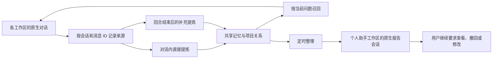

# 原生工作区与全局记忆接入

更新：2026-11-04。

## 交互约定

DSH 原生工作区和原生会话页面负责全部对话。插件不提供聊天页、消息输入框、会话列表或另一套聊天导航。全局面板中的“助手管理”只提供记忆、项目、日历、任务、工具、收件箱与设置。

插件启动时按配置目录注册 DSH 原生“个人助手”工作区。用户在这里提出个人需求；插件执行的任务、微信会话和定时整理报告也归入该工作区。其他工作区继续使用原来的 Agent 预设、工具、权限和工作目录。

## 全局接入

“全局”指安装并运行本插件的同一个 DSH Host 内全部工作区的用户会话，不以 personal-assistant 预设为准。已有会话恢复后产生的新消息也参与处理；不会在启用时全量扫描磁盘上的历史日志。

Host 全局加载工具和 system-prompt/assemble 接入，不修改其他预设文件。召回内容受字符预算约束，只提供与当前问题相关的记忆。来源保留原工作目录、预设、会话 ID 和消息 ID，因此经验可以跨工作区使用，归属仍可追踪。

当前会话中的模型可以直接创建项目、提炼记忆、管理日程和任务。真实用户输入先进入 buffered 状态；回合结束时，尚未处理的来源转为 pending。后台每 30 秒检查积压，已经 captured 或 ordinary 的来源不重复提炼；中断后仅恢复当前未运行会话的来源。关闭自动维护会停止后台补充提炼与定时维护，对话中明确调用的业务操作仍可使用。

子 Agent、运行时注入的时间消息、维护报告不作为独立个人记忆来源。子任务不自动读取全部私人记忆，由父会话传递当前任务需要的内容。报告会话后续收到用户真正的新消息时恢复正常记忆能力。

## 整理与报告

整理继续使用同一 Worker、事务、版本校验、人工保护字段和加密差量。分类时按记忆类型生成允许的参数，偏好与经历不会因为模型传入 reusable=true 而变成通用方法。

每轮日常整理的结果包含处理来源数、变更批次、对象名称、修改字段和撤回期限。报告作为“个人助手”工作区的一条原生会话交付；汇报回合保留原生工具配置，但执行入口禁止工具操作，也不将报告重新提炼成记忆。报告使用专用消息来源标记。失败时在收件箱和报告中记录实际失败，不能把失败说成已完成。

用户可以在报告原生会话继续要求“查看这一批变更”“撤回这个修改”“保留我改过的正文”。这些操作读取当前版本，沿用默认 72 小时的撤回窗口。完整旧正文只保存在可到期回收的差量中，不重复写进报告。

## 数据迁移

业务目录与 DSH 的会话持久化分别负责不同内容。插件目录迁移记忆、关系、任务、工具、设置、附件和撤回资料；DSH 原生历史仍由宿主管理。迁移后按新目录注册个人助手工作区，在新的原生对话中召回迁移后的记忆。微信或插件启动的任务会话在原生记录不存在时重新建立并关联必要背景。

切换目录时检查所有活跃会话，等待来源写入队列完成。新目录通过摘要和数据格式检查后启用。外部工作目录在新设备不存在时回到插件自带工作目录，并通知用户重新指定。不会为了迁移而改写其他工作区的目录。

## 验证

- 已在 DSH 0.2.1-rc.5 的默认工作区、标准预设中，通过自然语言保存长期偏好并读取此前活动经验。
- 数据库确认来源预设为 standard，来源目录属于默认工作区；记忆进入同一业务库。
- 实际浏览器确认助手管理导航已无聊天页，原生工作区列表包含个人助手。
- 自动测试覆盖多工作区来源、子任务与运行时消息排除、回合结束后转交、重启积压恢复、已提炼来源不重复处理。
- 原生整理报告后继续对话、召回其他工作区偏好、只撤回指定批次已通过；数据库核对领域恢复为生活，其余批次保留。
- 汇报回合的消息没有进入来源表；后续真正用户消息正常参与记忆管理。
- 全局接入后的固定版本工作流仅执行一次指定工具，随后原生回合结束。
- 结果记录在正式实施与验收文档和 JSON 检查记录中。
